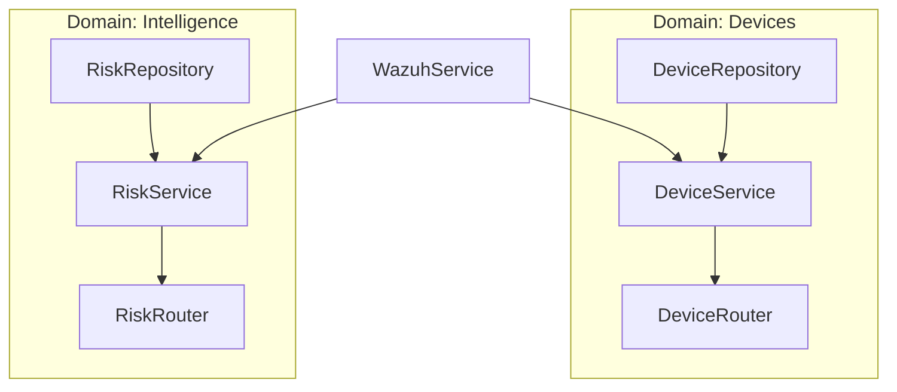

# Backend Architecture Design: Domain-Driven Service Pattern

This document defines the "Best Practice" architecture for the PeakSoft IoT Security Backend. It transitions the project from a flat structure to a scalable, testable, and modular **Domain-Driven Service Architecture**.

---

## 🏗️ The Layered Approach

The system is divided into three distinct layers to ensure separation of concerns:

### 1. API Layer (`app/api/`)
- **Responsibility**: Handling HTTP requests, routing, and input validation.
- **Components**: FastAPI Routers and Pydantic Schemas (DTOs).
- **Rule**: No business logic or direct database queries allowed here.

### 2. Service Layer (`app/domains/*/service.py`)
- **Responsibility**: Core business logic and orchestration.
- **Interaction**: Calls Repositories for data and External Services (like Wazuh) for enrichment.
- **Rule**: This is the "brain" of the application. It knows *what* to do, but not *how* data is stored.

### 3. Repository Layer (`app/domains/*/repository.py`)
- **Responsibility**: Data access and persistence.
- **Interaction**: Direct talk with the Database (SQLAlchemy/SQLModel).
- **Rule**: Decouples the application from the database engine. If we swap PostgreSQL for another DB, only this layer changes.

---

## 📂 Domain-Driven Structure (DDD)

Instead of grouping files by technical type (all services in one folder), we group them by **Business Domain**. This makes the project much easier to navigate as it grows.



### Example Layout:
```text
app/
├── core/               # Global Config, Security, Auth
├── db/                 # Session management, Base Repository
└── domains/            
    ├── devices/        # Everything related to IoT Device records
    │   ├── models.py   # SQLModel (DB Schema)
    │   ├── schemas.py  # Pydantic (API Schema)
    │   ├── service.py  # Business Logic
    │   └── repository.py # Database Logic
    └── intelligence/   # ML and Vulnerability logic
```

---

## 💉 Dependency Injection (DI)

We use FastAPI's `Depends` system to inject repositories into services, and services into routers. This makes the code **100% Testable**.

**Why it's better:**
- We can inject a "Fake Repository" during tests to avoid hitting the real database.
- It prevents "Circular Imports" which are common in large Python projects.

---

## 🧩 Data Transfer Objects (DTOs)

We strictly separate **Internal Models** from **External Schemas**:
- **Models**: Used only for database tables (SQLModel).
- **Schemas**: Used for API input/output (Pydantic). 
- *Benefit*: We can change our database table without breaking our public API for users (like Farah).

---

## 🛠️ Implementation Checklist
1. [ ] Define `BaseRepository` with generic CRUD (Create, Read, Update, Delete).
2. [ ] Centralize application settings in `core/config.py` using Pydantic Settings.
3. [ ] Implement Global Exception Handlers to return clean JSON errors.
4. [ ] Enable SQL logging via a single toggle in `config.py`.
