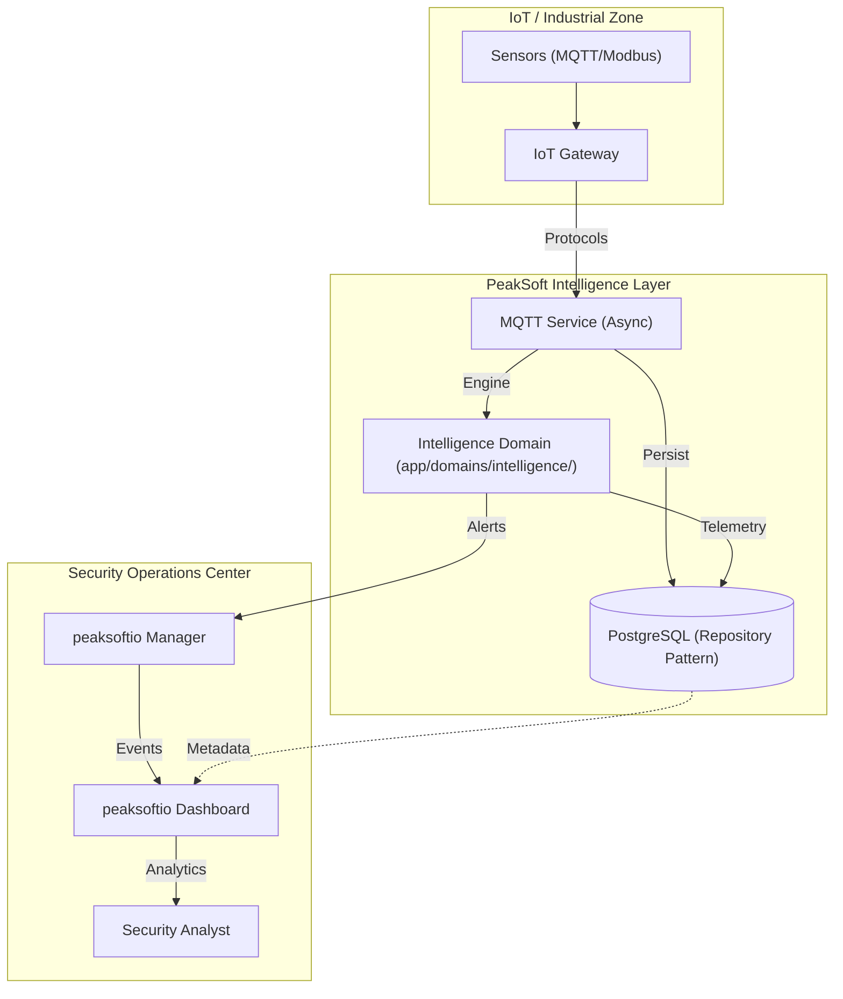

# PeakSoft Security Platform: Concepts & Implementation Journal

This journal provides a comprehensive technical breakdown of the PeakSoft Security Platform's development. It documents the evolution from a basic containerized stack to a sophisticated, event-driven security intelligence system.

---

## 📘 How to Use This Document

- **Audience**: Backend engineers, security engineers, platform/DevOps, and technical stakeholders who want to understand *how* the system is built and *why* certain decisions were made.
- **Scope**: Focuses on the **Intelligence Layer** (backend) and its integration with the broader PeakSoft/Wazuh stack. It is a design and implementation journal, not a user guide.
- **Navigation**:
  - Start with **High-Level System Architecture** if you are new to the project.
  - Jump to specific phases (Database, MQTT, AI, etc.) when working on a related feature.
  - Use the **Code Map** section at the bottom to locate concrete implementations in the repository.

---

## 🏗️ High-Level System Architecture

The platform architecture is designed for scalability, low latency, and deep integration with the peaksoftio security ecosystem.



---

## 🐳 Core Infrastructure & Orchestration

### The Concept
A modern security platform requires a unified, portable deployment model. We chose Docker Compose to orchestrate the "Stack of Stacks" (peaksoftio + Indexer + Backend + Database + Broker).

### What We Faced
- **Service Race Conditions**: The backend would frequently crash on startup because it tried to connect to PostgreSQL or Mosquitto before they were fully initialized.
- **peaksoftio Setup Complexity**: The standard peaksoftio Docker images are designed for general-purpose use and often fail when custom configuration paths are mounted without pre-existing files like `ar.conf`.

### What We Did
- **Python 3.10 Upgrade**: Upgraded the backend base image from Python 3.9-slim to **Python 3.10-slim** to resolve dependency conflicts with modern libraries like Pydantic v2 and ensure compatibility with newer Modbus libraries.
- **Health-Aware Deployment**: Configured `docker-compose.yml` with strict `healthcheck` requirements. The Backend now uses `service_healthy` conditions to wait for the Database and MQTT broker.
- **Surgical Volume Mounts**: 
    - Created a fix for the peaksoftio Manager by mounting an empty `ar.conf` to bypass the "missing file" startup error.
    - Path-corrected the `indexer-security-init.sh` via volume mount to fix a directory mismatch in the default indexer image.

### Why We Chose That
- **Docker Compose** provides a predictable networking environment (internal DNS), allowing services to communicate via hostnames like `postgres` or `mosquitto` instead of volatile IP addresses.

---

## ⚙️ System Qualities & SLAs

This section defines the non-functional expectations for the platform and informs capacity planning and performance work.

- **Throughput Targets**
  - Ingestion path (MQTT + Modbus) should comfortably handle **thousands of messages per minute** from heterogeneous devices.
  - Writes to PostgreSQL should remain non-blocking, with back-pressure handled via async workers and durable queues.
- **Latency Targets**
  - Typical API endpoints (CRUD, queries) should respond within **\< 200ms** under nominal load.
  - Telemetry → alert pipeline (message received → Wazuh alert generated) should complete within **\< 5 seconds** in the common case.
- **Availability & Resilience**
  - The system should tolerate short-lived failures of individual services (e.g. MQTT broker restart, DB failover) without data loss beyond what is acceptable for best-effort telemetry.
  - Critical components (DB, MQTT broker, Wazuh manager) should expose health endpoints and be monitored continuously.
- **Security & Compliance**
  - All network paths across trust boundaries (e.g. IIoT zone → backend, backend → Wazuh) are expected to be encrypted (TLS/mTLS) in production deployments.
  - Access to management APIs must require authentication and role-based authorization.

---

## 📊 Monitoring, Observability & Failure Handling

To operate the platform reliably, we treat observability as a required feature, not an afterthought.

### Logging

- **Correlation IDs**: Where possible, include `device_id`, MQTT topic, and request IDs in log lines to trace flows across services.
- **Structured Logs**: Use structured logging (JSON or key-value style) for ingestion services (`mqtt_service`, `modbus_service`, DPI) to make searching easier in OpenSearch/Wazuh.
- **Error Logging Strategy**:
  - Telemetry parsing errors should be logged with **topic + raw payload (truncated)** and never crash the service.
  - Integration errors (DB down, Wazuh unavailable) should be logged at `ERROR` level with enough context for diagnosis.

### Metrics

- **Core Metrics** (exported via Prometheus-compatible endpoints where possible):
  - Ingestion rate (messages/sec) per protocol.
  - DB write latency and error rate.
  - Alert generation rate and failure rate for Wazuh integrations.
- Use these metrics to validate the SLAs defined above and to detect regressions after deployments.

### Failure Modes & Recovery

- **MQTT Broker Unavailable**
  - `MqttService` should use reconnect logic with exponential backoff.
  - Messages published while the broker is down may be lost unless retained/persistent QoS is configured; this is acceptable for non-critical telemetry but *must* be documented.
- **Database Unavailable**
  - Ingestion services should surface clear errors and avoid blocking the entire event loop.
  - In the future, an in-memory or file-backed buffer can be introduced for short-lived outages.
- **Wazuh / Dashboard Unavailable**
  - Alerts are still persisted locally in the backend; forwarding to Wazuh resumes when connectivity is restored.

---

## 🔐 Security & Threat Model (High Level)

This section documents the primary assets, trust boundaries, and threats the platform is designed to handle.

### Assets

- Device registry and telemetry stored in PostgreSQL.
- Vulnerability and risk data used for decision making.
- Alert streams flowing into Wazuh and dashboards.

### Trust Boundaries

- **IoT / Industrial Zone → Intelligence Layer**
  - Untrusted or semi-trusted network; devices may be compromised or misconfigured.
- **Intelligence Layer → Security Operations Center (Wazuh + Dashboards)**
  - More trusted environment, but still hardened as if exposed to motivated attackers.

### Key Threats & Mitigations

- **Spoofed or Malicious Telemetry**
  - Mitigation: Topic conventions tied to device registry, anomaly detection (DPI + ML), and alerts on unusual patterns.
- **Replay Attacks**
  - Mitigation: Timestamp normalization + future rules to detect out-of-window timestamps or duplicated payload hashes.
- **Compromised IIoT Gateway**
  - Mitigation: Strict least-privilege credentials for MQTT, separate service accounts for DB access, and audit logging of administrative actions.
- **Data Exfiltration / Unauthorized Access**
  - Mitigation: Enforced authentication and RBAC on management APIs, encryption-in-transit, and Wazuh rules for suspicious API usage.

This is not an exhaustive threat model but a starting point that should evolve with new features (protocol support, AI models, compliance automation).

---

## 🗺️ Code Map & Implementation Pointers

Use this section to jump from concepts in this journal to the concrete implementation in the repository. Paths are relative to the repository root.

- **Core Framework**
  - `iot-security-backend/app/main.py` — application entry point and lifespan management.
  - `iot-security-backend/app/core/config.py` — centralized Pydantic settings.
  - `iot-security-backend/app/db/` — session management and base repository.
- **Backend Services & Domains**
  - `iot-security-backend/app/services/mqtt_service.py` — asynchronous MQTT client integrated with `TelemetryRepository`.
  - `iot-security-backend/app/services/modbus_service.py` — Modbus polling with `DeviceRepository` synchronization.
  - `iot-security-backend/app/domains/devices/` — Models, repositories, and services for IoT device management.
  - `iot-security-backend/app/domains/intelligence/` — OpenSearch/Wazuh integration and AI logic.
- **Data Models & Persistence**
  - `iot-security-backend/app/domains/devices/models.py` — unified SQLModel definitions.
  - `iot-security-backend/scripts/seed_db.sh` — database seeding script.
  - `iot-security-backend/scripts/mqtt_simulator.py` — updated telemetry simulator.
- **API Layer**
  - `iot-security-backend/app/api/v1/devices.py` — service-driven API endpoints.
- **Frontend Layer (IoT Security Plugin)**
  - `wazuh-dashboard/plugins/iot-security/public/application.tsx` — tabbed entry point for domain separation.
  - `wazuh-dashboard/plugins/iot-security/public/components/ThreatIntelligence.tsx` — independent security intelligence domain.
  - `wazuh-dashboard/plugins/iot-security/public/components/GovernanceReliability.tsx` — independent compliance and industrial domain.
- **Dashboards & Wazuh Integration**
  - `wazuh-dashboard/plugins/iot-security` *(under development)* — custom React components.

When adding significant new components, extend this section so that future contributors can quickly find the relevant implementation areas.

---
---
182: ## 🛠️ Simulators vs. Production Ingestion
183: 
184: For development and demonstration, the platform uses containerized simulators. Transitioning to a production environment with real physical devices requires reconfiguring the protocol endpoints.
185: 
186: ### Current Development State (Simulator Mode)
187: - **MQTT**: The `mqtt_simulator.py` publishes data to the `mosquitto` container.
188: - **Modbus**: The `modbus-simulator` container runs a TCP server on port 5020.
189: - **Discovery**: The backend is configured via `MODBUS_HOST=modbus-simulator` and `MQTT_BROKER_URL=mosquitto`.
190: 
191: ### 🚀 Transitioning to Production (Real Devices)
192: To switch from simulators to physical industrial hardware, follow these steps:
193: 
194: #### 1. Update Infrastructure Configuration
195: In `wazuh-docker/multi-node/docker-compose.yml`:
196: - **Remove/Comment**: The `modbus-simulator` service.
197: - **Update Backend Environment**:
198:   - `MODBUS_HOST`: Set to the IP address or DNS name of your physical PLC/Gateway.
199:   - `MODBUS_PORT`: Typically `502` for standard Modbus TCP.
200:   - `MQTT_BROKER_URL`: If using an external broker (e.g., Azure IoT Hub, AWS IoT, or a site-wide MQTT server), update this to the production address.
201: 
202: #### 2. Protocol Tuning
203: Update the `MODBUS_POLLING_INTERVAL` in settings if your hardware requires lower frequency (e.g., every 60s) or supports higher frequency (e.g., every 5s) polling.
204: 
205: #### 3. Security Hardening
206: - Change default MQTT credentials (`MQTT_USERNAME`/`MQTT_PASSWORD`) to unique, long-lived secrets.
207: - Ensure the industrial network is isolated or connected via a secure VPN/Gateway.
208: 
209: ---

### What We Faced
- **Plugin Interdependency**: Simply deleting folders sometimes crashed the dashboard because the main `peaksoftio` plugin expected certain telemetry data from deleted sources.

### What We Did
- **Surgical Pruning**: Identified and removed 8 non-essential plugins (Maps, Newsfeed, APM).
- **Custom Build Environment**: Configured a system to build the dashboard from source, ensuring that the final Docker image only contains the code necessary for PeakSoft operations.

### Rationale
- **Performance**: A pruned dashboard has a smaller memory footprint and loads significantly faster in mission-critical scenarios.

---

## 🏛️ Phase 1: Database Foundation & Async Architecture

### Section 1.1: Relational Modeling with SQLModel
#### The Concept
To support Digital Twins, we need a schema that tracks both static device metadata (IP, OS, Type) and dynamic telemetry (Temperature, Pressure, CPU).

#### What We Faced
- **Code Duplication**: Usually, developers write Pydantic classes for the API and SQLAlchemy classes for the Database. This leads to "Sync Drift" where the two models become inconsistent.

#### What We Did
- **Domain-Driven Service Architecture**: Restructured the entire backend into isolated domains (`devices`, `intelligence`, etc.).
- **Repository Pattern**: Introduced a data access layer to decouple business logic from SQLAlchemy/SQLModel internals.
- **Unified Modeling**: Implemented **SQLModel** classes within domain folders.
- **Asynchronous Driver**: Used `asyncpg` for non-blocking I/O.
- **Dependency Injection**: Leveraged FastAPI `Depends` to inject services and repositories into API routers.

#### Why We Chose That
- This architecture represents the "Best Practice" for professional FastAPI services, ensuring maximum testability, readability, and long-term maintainability as the platform scale.

---

## 📡 Phase 2: Protocol Engineering — MQTT Broker Setup

### The Concept
MQTT is a lightweight "Publish/Subscribe" protocol. It is essential for industrial environments where devices may have limited power or bandwidth.

### What We Faced
- **Container Networking**: Accessing the broker from both inside the Docker network (by the backend) and outside (by physical devices/simulators) required careful port mapping.

### What We Did
- **Broker Deployment**: Integrated **Mosquitto** (Eclipse) into the stack.
- **Security Baseline**: Configured a persistence layer so that MQTT messages are saved to disk even if the container restarts. Prepared the system for RBAC (Role-Based Access Control) using a password file mount.

### Why We Chose That
- **Mosquitto** is the industry gold standard for open-source MQTT. It is stable, supports MQTT 5.0, and integrates seamlessly with Python-based subscribers.

---

## 📡 Phase 2: Protocol Engineering — Backend MQTT Client

### The Concept
The Backend must "listen" to all factory telemetry and update the Digital Twin in real-time.

### What We Faced
- **The "Blocking" Problem**: Most MQTT libraries are synchronous. If the backend waited for an MQTT message, it couldn't handle web requests from the dashboard at the same time.
- **FastAPI Lifespan Management**: We needed a way to start the MQTT client automatically when the container boots and shut it down cleanly when it stops.

### What We Did
- **Async Subscriber**: Implemented `MqttService` using **gmqtt**. This library is natively asynchronous and integrates perfectly with FastAPI's `asyncio` loop.
- **Lifespan Integration**: Hooked the service into the FastAPI `lifespan` event:
  ```python
  @asynccontextmanager
  async def lifespan(app: FastAPI):
      asyncio.create_task(mqtt_service.start()) # Non-blocking background task
      yield
      await mqtt_service.stop()
  ```
- **Pattern Matching**: Configured the client to subscribe to `factory/+/telemetry`, allowing it to dynamically pick up messages from any device in the factory.

### Why We Chose That
- **gmqtt** allows the backend to handle thousands of messages per second while remaining responsive to API calls. The `asyncio.create_task` pattern ensures the MQTT listener runs as a lightweight "green thread" in the background.

---

## 📡 Phase 2: Protocol Engineering — MQTT Message Parsing & Telemetry Ingestion

### The Concept
Raw MQTT messages from the factory are only useful if they can be normalized into structured telemetry that the database, AI engine, and dashboards can understand. This step turns loosely formatted JSON payloads into validated `Telemetry` records tied to a specific `Device`.

### What We Faced
- **Topic-Derived Identity**: Device identifiers are encoded in the topic (`factory/{device_id}/telemetry`), not in the payload. A naive implementation would hardcode topic names and break as soon as new devices appear.
- **Payload Variability**: Different devices and simulators may send slightly different JSON structures (extra fields, missing fields, different casing).
- **Error Surface Area**: Malformed JSON or unexpected data types (strings instead of numbers) could crash the subscriber if not handled defensively.
- **Time Semantics**: Some devices send their own timestamps, while others rely on the server's receive time. We needed a consistent strategy.

### What We Did
- **Topic Parsing Utility**: Implemented a small helper that extracts `device_id` from topics matching the pattern `factory/{device_id}/telemetry`. This keeps the `MqttService` agnostic to the specific factory layout while still enforcing a clear convention.
- **Canonical Telemetry Schema**: Defined a normalized telemetry structure (e.g. `temperature`, `pressure`, `status`, `payload_size`) and mapped it to the existing `Telemetry` SQLModel, ensuring that all incoming messages are validated before persistence.
- **Defensive JSON Parsing**: Wrapped deserialization in a try/except layer that:
  - Rejects malformed JSON gracefully
  - Logs parsing errors with topic + raw payload for later analysis
  - Applies defaults for optional fields instead of failing hard
- **Timestamp Normalization**: If the payload contains a `timestamp`, we parse it into **UTC** and then drop the timezone information so it matches the `TIMESTAMP WITHOUT TIME ZONE` column in PostgreSQL; if it's missing or invalid, we fall back to the server's receive time. This avoids subtle bugs with offset-aware vs. offset-naive datetimes and gives us consistent time-series data for analytics and ML.
- **Async Database Writes**: Used the existing async session factory to insert telemetry records without blocking the event loop, allowing high-throughput ingestion from multiple devices.
- **Foreign Key Integrity**: The `telemetry.device_id` column is a foreign key to `devices.id`. Telemetry is only accepted for devices that exist in the registry; otherwise the insert fails and is logged. The default MQTT simulator is aligned with the seeded devices (`dev-001`, `dev-002`, `dev-003`) to keep tests simple.

### Why We Chose That
- **Schema-First Thinking**: By enforcing a canonical telemetry shape at the edge, later components (AI models, dashboards, reports) can rely on clean, predictable data.
- **Resilience Under Noise**: Industrial environments are noisy by nature. Defensive parsing and topic-based identification ensure that bad messages are isolated and logged instead of taking down the entire pipeline.
- **Future-Proofing for ML**: Normalized timestamps and consistent field names make it trivial to export data for feature engineering and anomaly detection in later phases.

---

## 📡 Phase 2: Protocol Engineering — Real-time Digital Twin Synchronization

### The Concept
For a Security Analyst, "Live Status" is not just about seeing that a message arrived; it's about seeing the *current state* of the device (e.g., Temperature: 22°C, Status: OK) directly in the dashboard without digging into raw logs.

### What We Faced
- **Data Fragmentation**: Telemetry was stored in a "write-only" time-series table. The `Device` registry, which the dashboard actually displays, remained stale even as thousands of messages arrived.
- **Timestamp Drift**: The API was incorrectly overriding the `last_seen` field every time the dashboard refreshed, masking the true connectivity status of the devices.

### What We Did
- **In-Memory State Merge**: Updated the `MqttService` to not only persist telemetry but also fetch the corresponding `Device` record and update its `digital_twin_state` (JSON) and `last_seen` (timestamp) fields in the same transaction.
- **State-Aware Registry**: Cleaned up the `devices` API to remove the artificial timestamp overrides. Now, `last_seen` only moves forward when real-time protocol data is processed.
- **Telemetry History API**: Added a `GET /devices/{id}/telemetry` endpoint to allow the dashboard to fetch the last 50 metrics for detailed analysis/triage.

### Why We Chose That
- **Direct UI Binding**: By mirroring the latest telemetry into the `Device` model, the Wazuh Dashboard can display the "Digital Twin" state instantly with zero extra queries, fulfilling the "Single Pane of Glass" requirement.
- **Operational Integrity**: Removing the API-side timestamp override ensures that "Last Telemetry" is a source of truth for device health, not just a proof that the dashboard is open.

---

## 📡 Phase 2: Protocol Engineering — Modbus TCP Integration

### The Concept
Modbus is the "lingua franca" of industrial automation. Unlike MQTT's reactive "push" model, Modbus typically requires the server to "pull" (poll) data from devices.

### What We Faced
- **Protocol Heterogeneity**: We needed a way to manage both asynchronous "push" telemetry (MQTT) and scheduled "pull" telemetry (Modbus) without blocking the FastAPI event loop.
- **Binary Data Mapping**: Modbus values are stored in 16-bit registers (Integers). We needed a mapping layer to turn "Register 0" into "Temperature: 22.5°C".

### What We Did
- **Polling Service**: Implemented `ModbusService` using **pymodbus** and **APScheduler**. It runs as a background task, polling configured devices at a defined interval (default 30s).
- **Canonical Normalization**: The service parses raw 16-bit registers (e.g., dividing by 10 for decimal precision) and maps them to the same `Telemetry` SQLModel used by MQTT.
- **Unified Digital Twin**: Just like MQTT, Modbus telemetry updates the `digital_twin_state` in the `Device` model, ensuring the dashboard remains agnostic to the underlying protocol.

### Why We Chose That
- **pymodbus (Async)**: Allows the backend to poll multiple industrial devices concurrently without stalling.
- **APScheduler**: Provides a robust, thread-safe way to manage periodic tasks within an asynchronous application.

### Tooling & Simulators
- **Modbus TCP Simulator**: `iot-security-backend/scripts/modbus_simulator.py` simulates a virtual PLC with registers for temperature and pressure. Accessible via `run_simulator.sh`.

### Tooling & Simulators
- **MQTT Telemetry Simulator**: `iot-security-backend/scripts/mqtt_simulator.py` publishes realistic telemetry for seeded devices (`dev-001`, `dev-002`, `dev-003`) on topics like `factory/dev-001/telemetry`. It is typically run inside the `iot-security-backend` container via:
  - `docker compose exec iot-security-backend python scripts/mqtt_simulator.py --count 10 --interval 1`
- **Simulator Runner Script**: `iot-security-backend/scripts/run_simulator.sh` provides a small TUI-style menu to launch either the MQTT telemetry simulator or the Wazuh/OpenSearch alert simulator from the host without worrying about Python environments.
